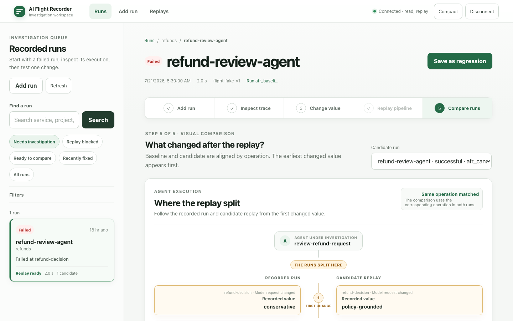
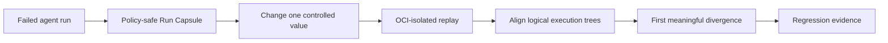

<h1 align="center">AI Flight Recorder</h1>

<h3 align="center">Reproduce the run. Freeze the world. Find the first divergence.</h3>

<p align="center"><strong>An open-source causal regression debugger for production AI agents.</strong><br />Turn one failed execution into a portable experiment: capture the evidence, replay it with external boundaries frozen, change one variable, and see exactly where the new path splits.</p>

<p align="center">
  <a href="https://github.com/krishnangopal1810/ai-flight-recorder/actions/workflows/verify.yml"></a>
  <a href="https://github.com/krishnangopal1810/ai-flight-recorder/stargazers"></a>
  <a href="LICENSE"></a>
  <a href="https://opentelemetry.io/"></a>
</p>

<p align="center">
  <a href="#see-it-in-action">Try the real investigation</a> ·
  <a href="#how-it-works">How it works</a> ·
  <a href="#more-than-another-trace-viewer">Why it is different</a> ·
  <a href="#safe-by-construction">Safety model</a> ·
  <a href="#documentation">Documentation</a>
</p>



<p align="center"><sub>The comparison view opens at the first aligned change: the original agent denied an eligible refund; a controlled replay changed one model input, kept recorded dependencies offline, and produced a successful candidate.</sub></p>

## A trace is evidence. A replay is an experiment.

AI agents fail across moving systems: prompts, models, retrieval indexes, tools, MCP servers, feature flags, code, and mutable APIs. By the time you investigate, the world that produced the failure has already changed.

Flight Recorder captures that world as an immutable **Run Capsule**, then lets you ask a much stronger question than “what happened?”

> **If I freeze every recorded dependency and change exactly one thing, does the failure still happen?**

The result is a controlled before/after execution, aligned by logical operation rather than timestamp, with the **first meaningful divergence** surfaced before its downstream effects.

## The debugging loop

1. **Capture a failed run** — ingest OTLP/OpenInference spans plus the provenance, artifacts, boundary responses, and policy needed to investigate it.
2. **Inspect it safely** — play back recorded evidence without running application code or contacting external systems.
3. **Change one value** — edit a model input or a recorded model, tool, retriever, API, or MCP response.
4. **Replay with the world frozen** — run the agent inside OCI isolation while recorded external results are substituted by default.
5. **Find the split** — align both execution trees and surface the earliest meaningful change, followed by its later effects.
6. **Keep the fix** — save evaluator evidence for local or CI regression testing, or run the experimental Git bisect workflow.

## See it in action

The fastest path launches the complete stack and records a real investigation. It requires **Go 1.25+**, **Node.js 22**, [**uv**](https://docs.astral.sh/uv/), **Git**, and **Docker**.

```sh
git clone https://github.com/krishnangopal1810/ai-flight-recorder.git
cd ai-flight-recorder
make bootstrap
make dev-up
```

The stack starts Flight Recorder, PostgreSQL, MinIO, and deterministic external dependencies. It then runs the instrumented refund-review agent in [`examples/investigation-agent`](examples/investigation-agent), captures an incorrect denial, and creates a successful isolated candidate replay through the normal product APIs.

Find the worktree-specific inspector URL:

```sh
./scripts/dev-stack.sh ps
```

Use the mapped HTTP URL and this intentionally fixed, loopback-only development token:

```text
frt_AAAAAAAAAAAAAAAAAAAAAAAAAAAAAAAAAAAAAAAAAAA
```

Then follow the product loop:

**Add a run → Inspect trace → Change one value → Replay pipeline → Compare runs**

When you are done:

```sh
make observe QUERY=metrics
make observe QUERY=capsules
# Then inspect one run:
./scripts/observe.sh traces <capsule-id>
make dev-down
```

<details>
<summary><strong>Prefer the embedded CLI workflow?</strong></summary>

Start the local service:

```sh
go run ./cmd/flight serve
```

In another terminal, initialize and record a replay-aware application:

```sh
go run ./cmd/flight init
go run ./cmd/flight record -- python app.py
go run ./cmd/flight capsule list --json
```

The CLI also supports passive playback, capsule import/export, completeness checks, controlled replay, semantic diff, evaluators, and experimental Git bisect. See the [generated CLI reference](docs/generated/cli.md).

</details>

## How it works



### Run Capsules capture the replayable context

A capsule joins the execution trace with the information that ordinary spans do not reliably preserve:

- source revision, dirty-worktree identity, build, runtime, dependency locks, and feature flags;
- prompts, model configuration, retrieval evidence, tool and MCP calls, artifacts, and evaluator evidence;
- canonical boundary identities and recorded responses;
- the replay entrypoint and explicit side-effect policy;
- a deterministic, content-addressed manifest that can be exported as a portable `.tar.zst` bundle.

Capsules declare whether they are complete enough for playback, replay, diff, and bisect. Missing evidence becomes a visible blocked state—not an excuse to call a live dependency.

### Controlled replay freezes external boundaries

Replay starts the registered application entrypoint from the beginning. Recorded tool, API, retrieval, MCP, and model results are substituted according to policy. Live reads require an explicit declaration; unknown and mutating boundaries are blocked by default.

### Semantic diff finds where behavior changed

Candidate and recorded runs are aligned as logical execution trees. Flight Recorder separates:

- **Evidence** — immutable facts captured from a run;
- **Observations** — computed differences between runs;
- **Hypotheses** — explanations supported by controlled evidence.

It does not turn correlation into a causal claim. It gives you a reproducible experiment and shows you where to look first.

## More than another trace viewer

Flight Recorder is designed to sit beside your observability stack, not replace it. It consumes OpenTelemetry and OpenInference, then adds the executable debugging layer that begins after a trace is captured.

| Your telemetry provides | Flight Recorder adds |
|---|---|
| Spans, events, inputs, and outputs | Replay provenance, artifacts, boundary policy, and portable Run Capsules |
| A historical view of the failure | Passive playback plus controlled full-run re-execution |
| Timeline or span comparison | Logical-tree alignment and the first meaningful divergence |
| Incident evidence | Versioned evaluators, CI regression handoff, and experimental revision search |

## Safe by construction

Replaying production failures is powerful enough to be dangerous. The safety model is part of the product, not a deployment footnote.

- **Policy before persistence.** Capture policy runs before durable storage, hashing, indexing, logs, metrics, or quarantine.
- **Playback executes nothing.** Recorded evidence remains inspectable even when replay workers or providers are unavailable.
- **No silent live fallback.** Missing or ambiguous replay evidence blocks execution instead of contacting the real dependency.
- **Side effects are closed by default.** Unknown and mutating boundaries are substituted or blocked unless a sandbox and explicit flag are present.
- **Replays are isolated.** Application containers run without direct external networking, production credentials, the Docker socket, or host-writable mounts.
- **Operational telemetry is payload-free.** Capsule prompts, outputs, documents, and tool arguments never become product telemetry.
- **Damaged evidence fails visibly.** Missing or corrupt payloads remain labelled at their original references while unaffected verified evidence stays available.

Read the full [security invariants](docs/SECURITY.md), [replay-isolation design](docs/design-docs/replay-isolation.md), and [reliability contract](docs/RELIABILITY.md).

## Built for real agent stacks

| Layer | V1 support |
|---|---|
| Ingestion | OTLP over HTTP and gRPC, OpenTelemetry, and OpenInference |
| SDKs | Native Python and TypeScript metadata and controlled-boundary libraries |
| Interfaces | Go CLI/service, REST, SSE, and a React investigation workspace |
| Storage | SQLite/filesystem locally; PostgreSQL and S3-compatible object storage for hosted deployments |
| Replay | Docker or configured Podman OCI runtime with a trusted replay gateway |
| Portability | Deterministic tar+zstd bundles, canonical JSON, and SHA-256 content identities |
| Deployment | Local CLI or single-tenant, customer-hosted service; no mandatory vendor cloud |

The inspector uses the generated API client. HTTP handlers, CLI commands, and UI code never access storage directly. See [Architecture](ARCHITECTURE.md) for the domain dependency model and runtime data flow.

## What V1 deliberately does not claim

Flight Recorder creates a controlled experiment; it does not promise universal or bit-for-bit determinism. It does not expose hidden model reasoning, transparently re-run mutating production tools, or prove causality from correlation. Git bisect is experimental, and design-partner validation is still part of the V1 plan.

That honesty matters: a debugging tool should make uncertainty smaller, not hide it.

## Develop and verify

The repository is built for agent-first, evidence-backed development. The most useful commands are:

```sh
make build          # Go binaries, SDKs, and inspector
make test           # Fast unit and SDK tests
make integration    # Storage and API contracts
make e2e            # Deterministic product journeys
make security       # Privacy and replay-isolation checks
make verify         # Every blocking local gate
```

`make harness-check` proves the complete workflow inside a fresh isolated worktree and retains logs, capsules, replay plans, diffs, screenshots, traces, and video for diagnosis. The [acceptance matrix](docs/ACCEPTANCE.md) maps product requirements to executable evidence.

## Documentation

- [Product requirements](ai-flight-recorder-prd.md) — the user problem, V1 promise, scope, and acceptance scenarios
- [Architecture](ARCHITECTURE.md) — domains, dependencies, runtime flow, and compatibility model
- [Security](docs/SECURITY.md) and [Reliability](docs/RELIABILITY.md) — non-negotiable runtime behavior
- [SDK contract](docs/SDK.md) — Python/TypeScript metadata, boundary matching, and replay semantics
- [Generated references](docs/generated/index.md) — API, schema, CLI, and database contracts
- [Operations](docs/OPERATIONS.md) — development stack, observability, backup, and recovery
- [V1 evidence audit](docs/V1_EVIDENCE.md) — implemented proof and remaining validation gaps
- [Repository knowledge base](docs/README.md) — the full documentation map

## Help build the debugger AI agents need

AI Flight Recorder is early, ambitious, and MIT licensed. The most valuable contributions start with a concrete failure story: what the agent did, which part of the world had moved by investigation time, and what evidence would have made the incident reproducible.

- Read the [agent map](AGENTS.md) before changing the repository.
- Open an [issue](https://github.com/krishnangopal1810/ai-flight-recorder/issues) with a failure mode, integration request, or focused proposal.
- Keep changes vertical: behavior, tests, docs, generated contracts, and observability should move together.

If you have ever lost an afternoon trying to reproduce an agent run that would not fail the same way twice, **star the repository**. It helps other AI engineers find the project—and tells us this problem is worth solving in the open.

## License

[MIT](LICENSE) © 2026 krishnangopal1810
