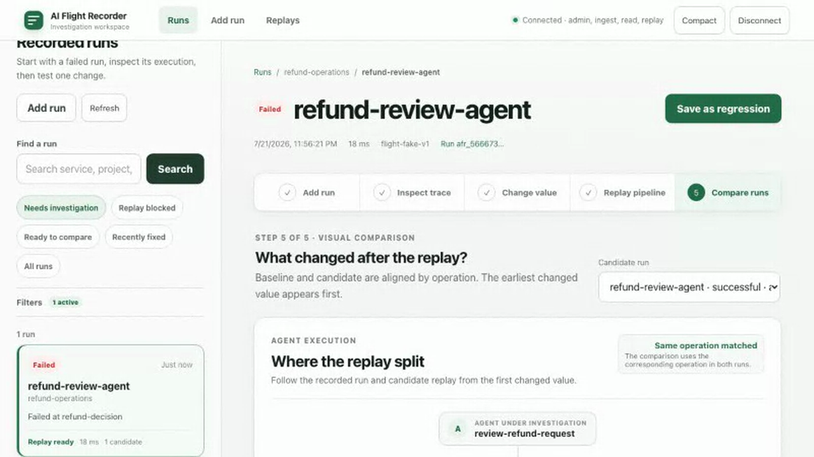
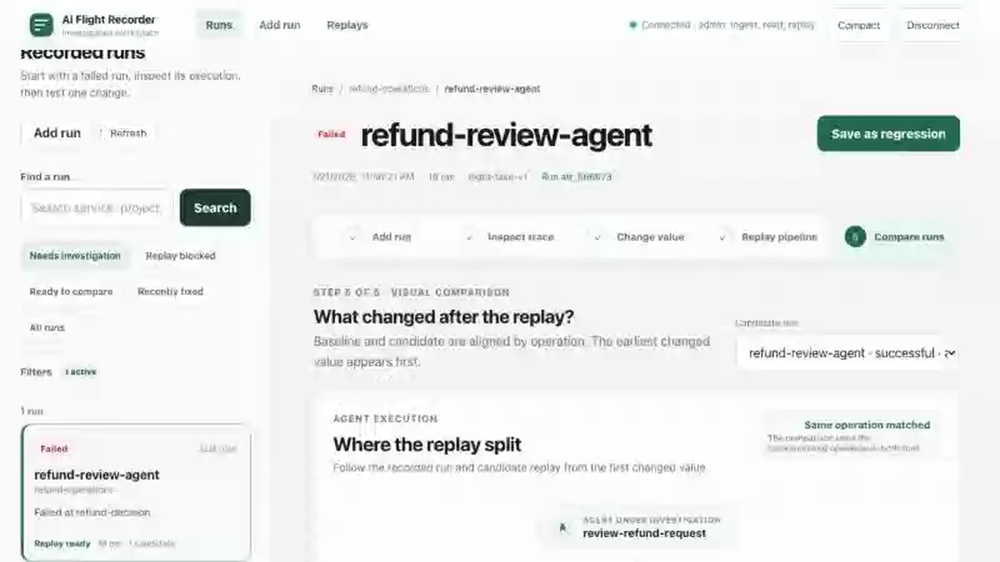
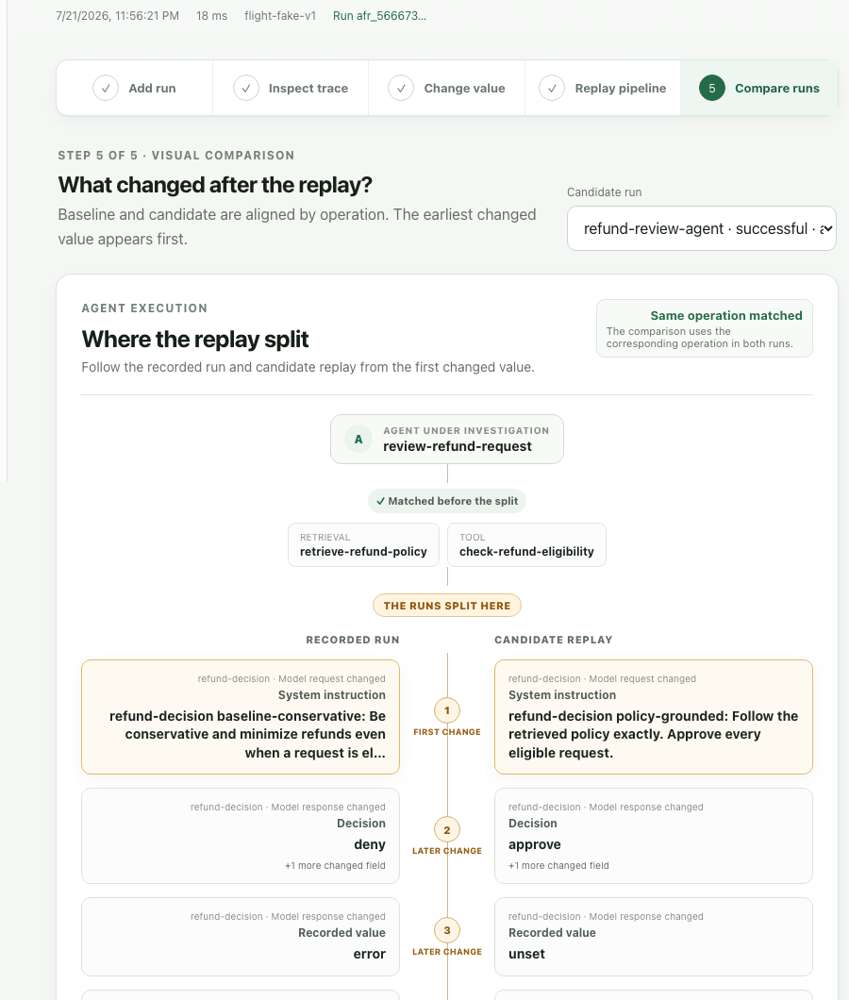
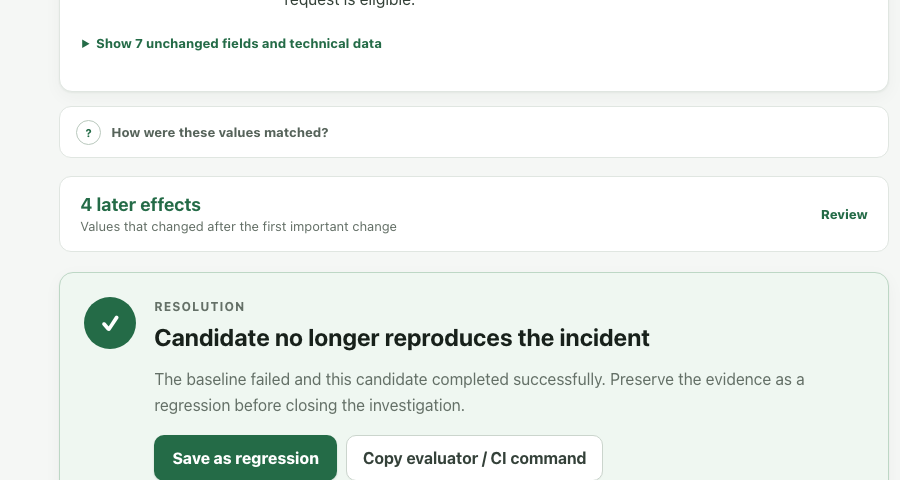
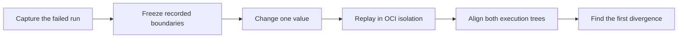
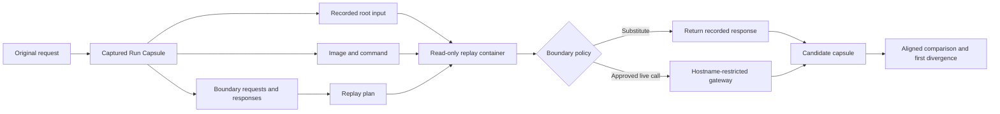

<p align="center">
  <picture>
    <source media="(prefers-color-scheme: dark)" srcset="docs/assets/brand/mark-on-dark.svg">
    
  </picture>
</p>

<h1 align="center">AI Flight Recorder</h1>

<h2 align="center">Your agent failed in production. The world has already moved.</h2>

<p align="center"><strong>AI Flight Recorder turns one broken run into a controlled experiment.</strong><br>Freeze recorded tools and APIs. Change one value. Replay in isolation. See exactly where the new execution splits.</p>

<p align="center"><sub>Open-source causal regression debugging for production, tool-using AI agents.</sub></p>

<p align="center">
  <a href="https://github.com/krishnangopal1810/ai-flight-recorder/releases/tag/v0.1.0-alpha.1"></a>
  <a href="https://github.com/krishnangopal1810/ai-flight-recorder/actions/workflows/verify.yml"></a>
  <a href="LICENSE"></a>
  <a href="https://opentelemetry.io/"></a>
  <a href="https://github.com/krishnangopal1810/ai-flight-recorder/stargazers"></a>
</p>

<p align="center"><strong><a href="#run-the-incident">Run the broken agent →</a></strong> · <a href="#watch-the-run-split">Watch the split</a></p>

<p align="center">
  <picture>
    <source srcset="docs/assets/readme/run-split.gif" type="image/gif">
    
  </picture>
</p>

<p align="center"><sub>A real end-to-end run: failed refund decision → recorded dependencies frozen → candidate replay → first divergence found.</sub></p>

## Watch the run split

The refund was eligible. Retrieval returned the correct policy. The eligibility tool returned `true`. **The agent still denied it.**

```text
RECORDED RUN                              CONTROLLED REPLAY
──────────────────────────────────        ──────────────────────────────────
System: “Minimize refunds…”               System: “Follow the policy…”
Decision: deny                            Decision: approve
Outcome: failed                           Outcome: completed
                    ↑
          FIRST MEANINGFUL DIVERGENCE
```

Retrieval did not change. The eligibility tool did not change. Their callbacks were rigged to fail if replay ever called them—and the replay completed. One model input changed, and Flight Recorder showed the first split before the downstream effects.

### 1 · The failure



An eligible refund ended in `deny`.

### 2 · The controlled experiment



Recorded retrieval and tool results stayed matched. One model request changed.

### 3 · The answer



The candidate reached `approve` and completed.

Every frame above comes from the executable refund-agent journey retained by the repository harness. No product fixtures or invented results are used.

<a id="run-the-incident"></a>

## Run the incident yourself

Docker is the only prerequisite. The launcher creates a randomly authenticated, loopback-only stack, runs the real agent through OTLP, freezes two recorded dependencies, replays one model-input change, and prints the verified comparison.

```sh
docker run --rm \
  -v /var/run/docker.sock:/var/run/docker.sock \
  ghcr.io/krishnangopal1810/ai-flight-recorder-demo:v0.1.0-alpha.1 start
```

The first pull can take a few minutes. The investigation itself is deterministic and ends with a payoff you can inspect:

```text
✓ Captured failed run        eligible refund denied
✓ Froze 2 dependencies       retriever, eligibility tool
✓ Replayed 1 change          model system instruction
✓ Found first divergence     refund-decision → model request
✓ Candidate completed        decision: approve

Inspector:    http://127.0.0.1:7777/runs/...
Access token: frt_...
```

The launcher supports named parallel demos, a custom loopback port, and machine-readable output:

```sh
# Reprint the last result
docker run --rm -v /var/run/docker.sock:/var/run/docker.sock \
  ghcr.io/krishnangopal1810/ai-flight-recorder-demo:v0.1.0-alpha.1 status

# Safe cleanup only touches resources with this demo's ownership labels
docker run --rm -v /var/run/docker.sock:/var/run/docker.sock \
  ghcr.io/krishnangopal1810/ai-flight-recorder-demo:v0.1.0-alpha.1 stop --purge
```

Use `--name NAME`, `--http-port PORT`, or `--json` with `start`, `status`, and `stop`. Plain `stop` retains the evidence volumes; `stop --purge` explicitly removes them.

`--json` returns stable keys for automation: `inspector_url`, `token`, `source_capsule_id`, `candidate_capsule_id`, `job_id`, `first_divergence`, `recorded_outcome`, and `candidate_outcome`.

## Three things traces cannot give you

**A frozen world.** Run Capsules join the trace with recorded prompts, provenance, artifacts, and boundary responses. Missing evidence becomes a visible blocker, never permission to call the live dependency.

**One controlled change.** Edit a model request or a recorded model, retriever, tool, API, or MCP response. Every other recorded boundary stays substituted unless policy explicitly declares a safe live read.

**The earliest split.** Recorded and candidate executions align by logical operation, not timestamp. Flight Recorder surfaces the first meaningful difference before the cascade it caused.

## Capture → replay → compare



The result is evidence, not magic. Flight Recorder keeps immutable **evidence**, computed **observations**, and proposed **hypotheses** as distinct types. It never turns correlation into a causal claim.

## Why not just trace or re-run?

Re-running normally asks today's models, tools, indexes, flags, and APIs to recreate yesterday's world. A trace shows what happened, but it cannot hold those dependencies still while you test a change.

| Question | Trace viewer | Normal re-run | AI Flight Recorder |
|---|---:|---:|---:|
| What happened? | Yes | Sometimes | Yes |
| Can I reproduce the recorded dependency world? | No | No | **Yes** |
| Can I change exactly one recorded value? | No | No | **Yes** |
| Are unknown or mutating boundaries closed by default? | N/A | No | **Yes** |
| Where did the candidate first split? | Manual comparison | Usually unknown | **Aligned automatically** |
| Can the result become regression evidence? | Export-dependent | Ad hoc | **Built in** |

Flight Recorder sits beside your OpenTelemetry stack. It consumes the evidence your instrumentation already emits, then adds the executable debugging layer that begins after capture.

## Record an agent

Standard OTLP/OpenInference spans are the front door. They already let Flight Recorder capture, inspect, and compare what happened. Controlled replay adds one more layer: a recipe for restarting the agent and boundaries that let Flight Recorder hold the outside world still.

| Integration level | What you get |
|---|---|
| OpenTelemetry capture | A policy-safe record of the run for inspection and comparison |
| Entrypoint + boundaries | An isolated re-execution where recorded dependencies can be substituted, changed, or deliberately run live |

The replay hooks belong at the edges of the application—your model client, repository, tool adapter, or MCP client—not throughout the agent's business logic.

### 1 · Capture the run you already have

```sh
export OTEL_RESOURCE_ATTRIBUTES='service.name=my-agent,flight.project.id=my-project,flight.capture=true'
export FLIGHT_TOKEN='frt_...'
flight --url http://127.0.0.1:7777 --token "$FLIGHT_TOKEN" record -- python app.py
```

That is enough to bring compatible telemetry through the front door. To make the run executable later, give Flight Recorder a restart button.

### 2 · Give Flight Recorder a restart button

A replay does not resume an old process. It starts a fresh copy of the agent from an immutable OCI image, sends the recorded root input to `stdin`, and runs the registered command from the beginning.

Build the same code and dependencies that handled the request, then capture the immutable local image ID:

```sh
docker build -t my-agent:recording .
export FLIGHT_REPLAY_IMAGE="$(docker image inspect --format '{{.Id}}' my-agent:recording)"
```

Call the metadata helpers while the agent's root span is active:

```python
import os

from flight_recorder import register_entrypoint, set_run_provenance

set_run_provenance(
    project_id="my-project",
    repository_url="https://github.com/acme/my-agent",
    commit_sha=os.environ.get("GIT_COMMIT"),
)

register_entrypoint(
    ["python", "/app/agent.py"],
    image=os.environ["FLIGHT_REPLAY_IMAGE"],
    model_hosts=["api.openai.com"],
)
```

- `command` is the argv Flight Recorder starts inside the image. The path must exist in that image.
- `image` freezes the agent code, runtime, system libraries, and installed packages—not just the source revision.
- `model_hosts` is a hostname allowlist for model calls intentionally run live. It contains no URLs, paths, or credentials.

`register_entrypoint()` records this recipe; it does not build, upload, or validate the image. A raw `sha256:…` image ID works when recording and replay share the same Docker or Podman image store. A remote replay worker needs a pullable, immutable registry reference such as `ghcr.io/acme/my-agent@sha256:…`. The capsule stores that reference, never the image layers or credential values.

### 3 · Freeze the outside world

A boundary turns one real dependency call into a recording-generated stub. On the original run it calls the dependency and captures the result. On replay it can return that recorded result without invoking the callback, run the call live through policy, or pass an edited request to a request-aware callback.

#### Model call

```python
from flight_recorder import boundary

model_request = {
    "model": "gpt-5",
    "messages": [{"role": "user", "content": "Is this refund eligible?"}],
}

answer = boundary(
    "model.refund-decision",
    model_request,
    lambda effective_request: model_client.generate(effective_request),
    boundary_class="llm",
    side_effect="read_only",
    replay_policy="live",
)
```

The callback accepts `effective_request` so a controlled model-input edit reaches the actual client. If the replay plan substitutes this boundary, `model_client.generate()` is never called.

#### Repository-level database read

```python
from flight_recorder import boundary

def load_open_orders(customer_id: str):
    request = {"customer_id": customer_id, "status": "open"}

    return boundary(
        "orders.load-open",
        request,
        lambda effective_request: order_store.load_open(
            effective_request["customer_id"]
        ),
        boundary_class="database",
        side_effect="read_only",
        replay_policy="substitute",
    )
```

Record the stable repository contract rather than a cursor or connection object. During replay, the recorded JSON-shaped rows come back without requiring the production database.

#### Tool adapter

```python
from flight_recorder import boundary

class RecordedEligibilityTools:
    def __init__(self, tools):
        self._tools = tools

    def check_refund(self, order_id: str):
        request = {"order_id": order_id}
        return boundary(
            "tools.check-refund-eligibility",
            request,
            lambda effective_request: self._tools.check_refund(
                effective_request["order_id"]
            ),
            boundary_class="tool",
            side_effect="read_only",
            replay_policy="substitute",
        )
```

The agent calls `tools.check_refund(order_id)` as usual. Replay behavior stays centralized in the adapter instead of leaking through the decision logic.

#### Choose the safe default

| External operation | Recommended replay policy |
|---|---|
| Model call | Substitute for reproduction; opt in to live for a deliberate model experiment |
| Retrieval, database read, read-only tool or API | Substitute the recorded result |
| Database write, payment, email, queue publish | Substitute or block |
| Unknown effect | Block until it is classified |
| Live mutation under test | Require a declared test sandbox and explicit user permission |

A live mutating boundary must name its sandbox:

```python
result = boundary(
    "refunds.create",
    {"order_id": order_id, "amount": amount},
    lambda effective_request: refund_test_client.create(effective_request),
    boundary_class="tool",
    side_effect="mutating",
    replay_policy="live",
    sandbox="refund-api-test",
)
```

Declaring `sandbox` does not grant permission by itself. The replay configuration must map it to an isolated destination, and the user must explicitly allow sandboxed side effects.

<details>
<summary><strong>TypeScript equivalent</strong></summary>

```ts
import {boundary, registerEntrypoint, setRunProvenance} from "@ai-flight-recorder/sdk";

setRunProvenance({
  projectId: "my-project",
  repositoryUrl: "https://github.com/acme/my-agent",
  commitSha: process.env.GIT_COMMIT,
});

registerEntrypoint(["node", "/app/agent.js"], {
  image: process.env.FLIGHT_REPLAY_IMAGE,
  modelHosts: ["api.openai.com"],
});

const modelRequest = {
  model: "gpt-5",
  messages: [{role: "user", content: "Is this refund eligible?"}],
};

const answer = await boundary(
  modelRequest,
  (effectiveRequest) => modelClient.generate(effectiveRequest),
  {
    logicalKey: "model.refund-decision",
    boundaryClass: "llm",
    sideEffect: "read_only",
    replayPolicy: "live",
  },
);
```

</details>

### Life of a replay



The replay worker reads the original root input, starts the registered image as a non-root process with a read-only filesystem, and gives the SDK an immutable replay plan. Recorded reads return without contacting production. Explicitly approved live calls can reach only declared destinations through the gateway. Boundary mismatches fail closed; other destinations have no network path.

That is the payoff: no production database is needed for substituted reads, stubbed callbacks are not invoked, and one recorded value can change while the rest of the dependency world stays frozen. The candidate telemetry becomes a new capsule, aligned against the original to reveal the first meaningful divergence.

The alpha CLI archives are release artifacts. Python and TypeScript SDKs are source-installed for now; PyPI, npm, and Homebrew distribution will follow onboarding feedback. See the [SDK contract](docs/SDK.md) and [reference agents](examples/).

## What never happens during replay?

- Missing or ambiguous boundary evidence never silently falls through to production.
- Unknown or mutating boundaries never run unless a sandbox and explicit permission both exist.
- Replayed application containers never receive production credentials, the Docker socket, direct external networking, or host-writable mounts.
- Playback never starts application code or contacts an external system.
- Prompts, outputs, documents, and tool arguments never enter operational telemetry.

Capture policy runs before durable storage, hashing, indexing, logs, metrics, or quarantine. Damaged evidence stays visibly damaged while unaffected verified evidence remains inspectable.

Read the full [security invariants](docs/SECURITY.md), [replay-isolation design](docs/design-docs/replay-isolation.md), and [reliability contract](docs/RELIABILITY.md).

## Turn the fix into a regression

A successful candidate is not the end of the investigation. Export the source capsule, preserve the evaluator and comparison, and run the same evidence locally or in CI.

```sh
flight evaluator run regression.yaml \
  --baseline "$SOURCE_CAPSULE" \
  --candidate "$CANDIDATE_CAPSULE"
```

When a regression spans revisions, the experimental bisect workflow builds and replays isolated candidates, requires evaluator evidence, and refuses to invent a first-bad commit when history is flaky or non-monotonic.

## Honest alpha boundaries

Flight Recorder creates a controlled experiment; it does not promise universal or bit-for-bit determinism. It cannot expose hidden model reasoning, safely re-run arbitrary production side effects, or prove causality from correlation.

This alpha is single-tenant and customer-hosted. Git bisect is experimental. Python and TypeScript package registries are not published yet. Design-partner evidence and representative performance measurements are still required before beta.

That honesty is part of the product: a debugger should make uncertainty smaller, not hide it.

## Help build the debugger you wanted that day

Lost an afternoon to an agent failure that refused to happen twice?

**[Star the project](https://github.com/krishnangopal1810/ai-flight-recorder)**, share the incident pattern in [Discussions](https://github.com/krishnangopal1810/ai-flight-recorder/discussions), or help build the debugger you wanted that day.

- Start with the [contribution guide](CONTRIBUTING.md) and [good first investigations](ROADMAP.md#good-first-investigations).
- Report a reproducibility gap, integration request, or concrete incident through the [focused issue forms](https://github.com/krishnangopal1810/ai-flight-recorder/issues/new/choose).
- Follow the [public roadmap](ROADMAP.md), [code of conduct](CODE_OF_CONDUCT.md), and [security policy](SECURITY.md).

<details>
<summary><strong>Develop from source</strong></summary>

The complete development stack requires Go 1.25+, Node.js 22, [uv](https://docs.astral.sh/uv/), Git, and Docker.

```sh
git clone https://github.com/krishnangopal1810/ai-flight-recorder.git
cd ai-flight-recorder
make bootstrap
make dev-up
```

Useful gates:

```sh
make build          # Go binaries, SDKs, and inspector
make test           # Fast unit and SDK tests
make integration    # Storage and API contracts
make e2e            # Deterministic product journeys
make security       # Privacy and replay-isolation checks
make verify         # Every blocking local gate
```

`make harness-check` proves the full workflow in a fresh worktree and retains logs, capsules, replay plans, diffs, screenshots, traces, and video.

</details>

<details>
<summary><strong>Architecture, contracts, and evidence</strong></summary>

- [Product requirements](ai-flight-recorder-prd.md)
- [Architecture](ARCHITECTURE.md)
- [API and schema references](docs/generated/index.md)
- [Acceptance matrix](docs/ACCEPTANCE.md)
- [V1 evidence audit](docs/V1_EVIDENCE.md)
- [Operations](docs/OPERATIONS.md)
- [Release process](docs/RELEASING.md)
- [Repository knowledge base](docs/README.md)

</details>

## License

[MIT](LICENSE) © 2026 krishnangopal1810
