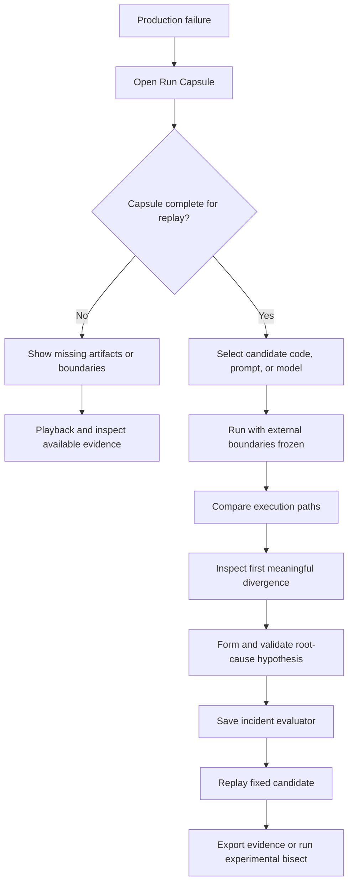
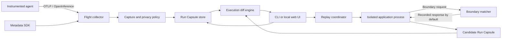
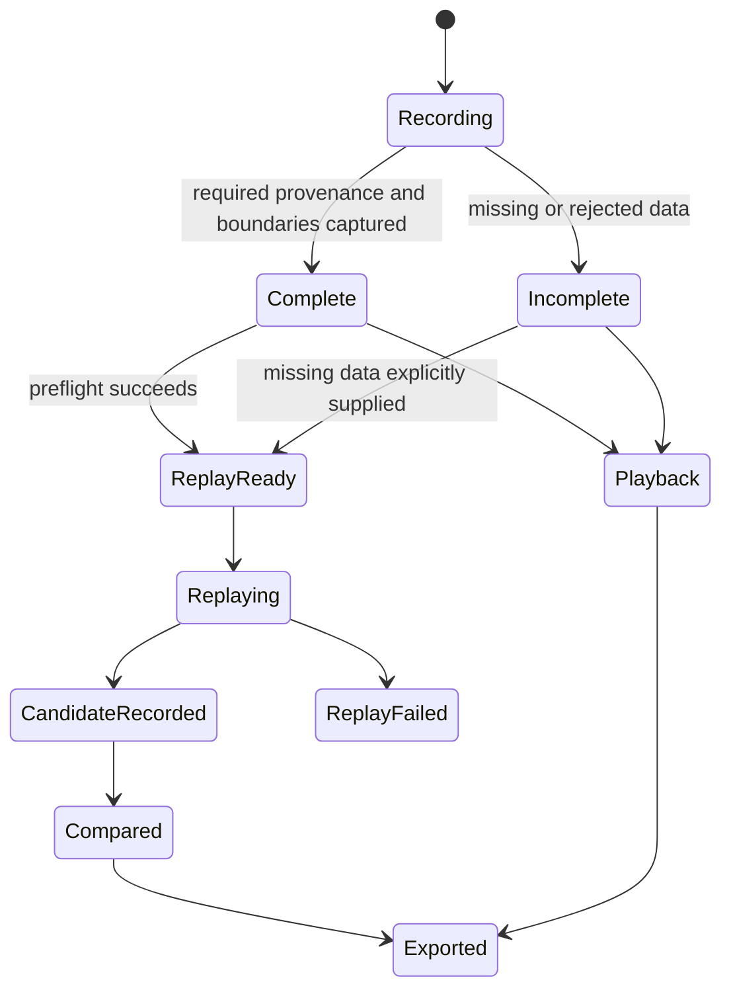
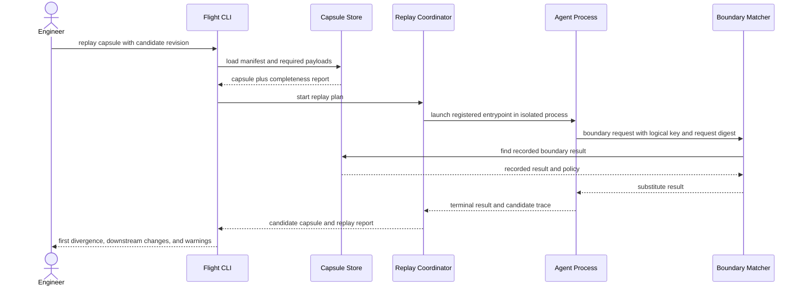

# AI Flight Recorder

## Product requirements document: reproduce and isolate agent failures

> **Status:** Draft for design-partner validation<br>
> **Owner:** Product and engineering<br>
> **Audience:** Product, design, engineering, security, and developer experience<br>
> **Version:** 0.1<br>
> **Landscape snapshot:** 21 July 2026<br>
> **V1 promise:** Reproduce a production agent failure under controlled boundaries and isolate the first meaningful divergence.<br>
> **Deployment:** Local CLI and single-tenant, customer-hosted service

---

## Contents

1. [Executive summary](#1-executive-summary)
2. [Problem, user, and job to be done](#2-problem-user-and-job-to-be-done)
3. [Market context and differentiation hypothesis](#3-market-context-and-differentiation-hypothesis)
4. [Goals, non-goals, and principles](#4-goals-non-goals-and-principles)
5. [Definitions](#5-definitions)
6. [User experience](#6-user-experience)
7. [Functional requirements](#7-functional-requirements)
8. [Interfaces and data contracts](#8-interfaces-and-data-contracts)
9. [Quality attributes and operational requirements](#9-quality-attributes-and-operational-requirements)
10. [Success metrics](#10-success-metrics)
11. [Acceptance scenarios](#11-acceptance-scenarios)
12. [Traceability](#12-traceability)
13. [Validation plan and hypotheses](#13-validation-plan-and-hypotheses)
14. [Rollout](#14-rollout)
15. [Risks and mitigations](#15-risks-and-mitigations)
16. [Full Platform TODO](#16-full-platform-todo)
17. [Deferred technical designs](#17-deferred-technical-designs)
18. [References](#18-references)

---

## 1. Executive summary

Production AI agents combine probabilistic models with prompts, retrieval, tool calls, MCP servers, external APIs, feature flags, code, and mutable data. When one fails, a trace can show the sequence of events but usually does not contain a complete, executable description of the environment that produced them. Engineers must manually reconstruct that environment, determine which dependencies changed, and compare runs whose steps may no longer align.

AI Flight Recorder is a causal regression debugger for production agents:

> **Observability records what happened. AI Flight Recorder reproduces the failure, isolates the first divergence, and helps locate the change that caused it.**

V1 turns an agent execution into a portable **Run Capsule** containing the trace, replay-relevant payloads, artifact versions, environment provenance, and explicit external-boundary policies. An engineer can play back the historical run, re-run the application from the beginning while substituting recorded external responses, and compare the original and candidate execution paths. An experimental Git bisect workflow searches between known-good and known-bad code revisions using one or more capsules and a user-supplied evaluator.

The product does not promise universal determinism, reveal hidden model reasoning, or prove causality from correlation. It creates a controlled experiment: freeze known external boundaries, change a selected variable, locate the earliest observed divergence, and present the evidence needed to validate a root-cause hypothesis.

### 1.1 Product decisions

| Decision | V1 choice |
|---|---|
| Primary user | Engineers operating multi-step, tool-using agents in production |
| Primary outcome | Reduce time from incident discovery to a validated root-cause hypothesis |
| Ingestion | OTLP/OpenTelemetry and OpenInference, supplemented by thin Python and TypeScript metadata SDKs |
| Recording | Full replay-relevant content captured inside customer infrastructure by default, with pre-persistence redaction and exclusions |
| Replay unit | Entire execution from its registered entrypoint |
| External behavior | Recorded retrieval, API, MCP, and tool results substituted by default |
| Side effects | Mutating tools never run by default; live execution requires a declared sandbox and an explicit flag |
| Comparison | Logical execution-tree alignment and first meaningful divergence |
| Bisect | Experimental; Git revisions and artifacts versioned with them only |
| Deployment | Local CLI plus Docker-deployable, single-tenant service; no mandatory vendor cloud |

---

## 2. Problem, user, and job to be done

### 2.1 Problem statement

An agent's behavior depends on more than application code. A small change to a prompt, model, retriever, document, tool schema, API response, feature flag, or dependency can change the trajectory without producing a conventional error. The resulting incident often has three distinct problems:

1. **Evidence is incomplete.** The trace may omit document versions, tool schemas, dependency state, feature flags, or code provenance.
2. **The environment has moved.** Re-running today may query a different index, call a changed API, or use a different model snapshot.
3. **The paths do not line up.** Once the agent makes a different choice, timestamps and span order are insufficient to show where the meaningful change began.

Engineers consequently spend hours reading spans and logs, reconstructing state, and testing explanations manually. They can see a failure without being able to reproduce or isolate it.

### 2.2 Primary persona

**Agent platform engineer / AI infrastructure engineer**

- Operates one or more multi-step agents serving production traffic.
- Owns instrumentation, incident response, evaluation, and release confidence.
- Uses multiple model providers, retrieval systems, and internal or MCP-connected tools.
- Can change application code and configuration but does not control every external dependency.
- Must keep prompts, customer content, tool payloads, and internal documents inside company infrastructure.

Secondary users are application engineers diagnosing a specific run and evaluation engineers converting incidents into regression cases. Security and compliance teams are stakeholders, not the initial daily user.

### 2.3 Job to be done

> When a production agent behaves incorrectly, help me recreate the relevant execution conditions, compare the failure with a controlled candidate run, and identify the first meaningful divergence so that I can validate a fix without risking another external side effect.

### 2.4 User outcomes

- Open a failed execution without assembling data from multiple systems.
- Know whether the capsule is complete enough for the requested replay.
- Freeze external responses while changing code, prompt, or model configuration.
- See the first meaningful change and its downstream effects.
- Distinguish recorded fact, observed difference, and inferred root cause.
- Turn the confirmed incident into a repeatable local or CI evaluation.

---

## 3. Market context and differentiation hypothesis

The market baseline already includes rich tracing and evaluation. Phoenix documents OpenTelemetry ingestion, traces of model, retrieval, and tool steps, self-hosting, LLM-span replay, and dataset experiments. LangSmith documents side-by-side trace and experiment comparison. Langfuse documents production tracing, datasets, experiments, evaluation, and open-source self-hosting. Braintrust documents trace inspection, prompt re-runs, versioned datasets, and a production-to-evaluation loop. W&B Weave documents versioning and visual comparison across code, traces, prompts, models, and configurations. [Phoenix](https://arize.com/docs/phoenix), [LangSmith trace comparison](https://docs.langchain.com/langsmith/manage-trace), [Langfuse evaluation](https://langfuse.com/docs/evaluation/overview), [Braintrust trace inspection](https://www.braintrust.dev/docs/observe/examine-traces), [W&B Weave comparison](https://docs.wandb.ai/weave/guides/tools/comparison)

V1 must therefore be evaluated against a narrower hypothesis: teams need an executable debugging layer above or alongside their trace store, not another general observability dashboard.

### 3.1 Documentation-based comparison

This table records the closest capability documented in the primary sources reviewed on 21 July 2026. “Validation focus” means the proposed distinction requires hands-on product testing and customer validation; it does not assert that a vendor lacks an undocumented capability.

| Product | Closest documented capability | Deployment note | Validation focus for Flight Recorder |
|---|---|---|---|
| Phoenix | Replays an individual LLM span with modified inputs; compares prompt/model experiments | Open source; Docker and Kubernetes self-hosting documented | Full application replay with recorded non-model boundaries and provenance-rich Run Capsules |
| LangSmith | Compares traces and experiments side by side; groups experiments by model, prompt, and tool metadata | Self-hosting is an Enterprise add-on | Executable environment reconstruction, boundary substitution, and first-divergence analysis |
| Langfuse | Connects traces, datasets, experiments, evaluators, and CI comparisons | Open-source Docker and production self-hosting documented | Replayable full-run capsule, safe tool stubbing, and automated revision search |
| Braintrust | Inspects complete traces, re-runs prompt spans, versions datasets, and promotes production data to evaluations | Managed platform in the reviewed getting-started workflow | Full trajectory replay under frozen dependencies rather than prompt-only re-runs |
| W&B Weave | Visually compares code, traces, prompts, models, and configurations; versions application parameters | Account-backed platform in the reviewed workflow | Semantic first divergence plus automated Git bisect over controlled re-executions |

### 3.2 Differentiation hypothesis

The proposed wedge consists of four connected primitives:

1. **Run Capsule:** a portable manifest joining telemetry with code, configuration, artifacts, boundary responses, and capture policy.
2. **Boundary-frozen replay:** a full-run re-execution in which external observations are substituted from the capsule unless explicitly permitted.
3. **Execution-path diff:** semantic alignment that identifies the earliest meaningful divergence and separates evidence from hypothesis.
4. **Regression bisect:** repeated controlled execution across Git revisions to locate the first revision that fails a user-defined evaluation.

This differentiation remains a hypothesis until design partners demonstrate that it materially reduces diagnosis time compared with their existing trace-and-evaluation workflow.

### 3.3 Standards strategy

Flight Recorder will consume rather than replace observability standards. OpenTelemetry provides the trace transport and general semantic model. OpenInference adds AI-specific span kinds and attributes for LLM, agent, tool, retrieval, evaluator, and prompt operations. The OpenTelemetry GenAI registry also warns that tool definitions, arguments, and results may contain sensitive information; that risk drives local capture and pre-persistence policy enforcement. [OpenTelemetry semantic conventions](https://opentelemetry.io/docs/specs/semconv/), [OpenInference specification](https://arize-ai.github.io/openinference/spec/), [OpenTelemetry GenAI attributes](https://opentelemetry.io/docs/specs/semconv/registry/attributes/gen-ai/)

The metadata SDK will extend incoming telemetry only where replay requires information that standard spans do not reliably contain, such as a repository revision, dirty-worktree digest, replay entrypoint, artifact content hash, boundary identity, and side-effect classification.

---

## 4. Goals, non-goals, and principles

### 4.1 V1 goals

1. Produce a self-describing Run Capsule for a supported agent execution.
2. Play back the recorded execution without invoking application code or external systems.
3. Re-run a supported application from the beginning while substituting captured external results.
4. Align the original and candidate trajectories and surface the first meaningful divergence.
5. Prevent accidental side effects during replay.
6. Demonstrate an experimental Git bisect over versioned application code.
7. Operate entirely inside customer-controlled infrastructure.

### 4.2 Non-goals

- Universal or bit-for-bit deterministic model reproduction.
- Access to, inference of, or storage requirements for undisclosed chain-of-thought.
- General production monitoring, alerting, prompt management, or fleet operations.
- Automatic proof of causality; V1 ranks hypotheses supported by observed diffs.
- Replay from an arbitrary intermediate checkpoint.
- Transparent re-execution of mutating production tools.
- Independent bisect across model-provider snapshots, mutable indexes, or non-Git artifacts.
- Multi-tenant SaaS, enterprise RBAC, or compliance certification.
- Replacement of an existing OpenTelemetry collector or observability platform.

### 4.3 Product principles

1. **Evidence before explanation.** Recorded facts, observed differences, and inferred hypotheses must be visually and structurally distinct.
2. **Safe by construction.** Playback executes nothing; controlled replay substitutes external responses; side effects require an isolated sandbox and explicit intent.
3. **Incomplete is a state, not a surprise.** Every capsule declares completeness by boundary and explains which replay modes are safe.
4. **Reproducible at controlled boundaries.** The product promises control of recorded dependencies, not determinism inside an external model.
5. **Standards in, portable evidence out.** Ingest OTLP/OpenInference and allow a capsule to be exported without a proprietary backend.
6. **Local content stays local.** Product telemetry may report operational counts but never capsule payloads, prompts, outputs, documents, or tool arguments.

---

## 5. Definitions

| Term | Definition |
|---|---|
| Execution | One agent invocation from a registered entrypoint to a terminal result, error, timeout, or cancellation |
| Trace | The observed tree of spans emitted while an execution runs |
| Run Capsule | A versioned manifest and content-addressed payload set combining a trace with replay provenance, artifacts, boundary records, policy, and evaluations |
| Boundary | An operation whose result may depend on a model or external state: LLM, retriever, MCP call, tool, API, clock, randomness source, or other declared dependency |
| Playback | Rendering the recorded capsule without executing application code |
| Controlled replay | Re-running the registered application entrypoint while substituting recorded boundary results according to policy |
| Live boundary | A boundary explicitly permitted to execute during controlled replay |
| Logical operation key | A stable identity derived from instrumentation metadata, operation name, parent path, and optional developer-supplied key; used to align runs |
| First meaningful divergence | The earliest aligned operation where replay-relevant input, configuration, selected action, output, status, or child structure differs beyond the configured comparison rule |
| Supported incident | A failure whose application has a registered replay entrypoint, whose required artifacts are available, and whose relevant boundaries can be matched or are explicitly allowed to run |
| Reproduced incident | A controlled replay that satisfies the incident evaluator or recreates its declared failure predicate; exact text equality is not required unless the evaluator requires it |

---

## 6. User experience

### 6.1 Incident-debugging journey



### 6.2 System context



### 6.3 Run Capsule lifecycle



### 6.4 Controlled-replay sequence



---

## 7. Functional requirements

Priorities are **P0** for required v1 behavior and **P1** for important behavior that may follow the first internal prototype. Every requirement includes its acceptance condition and required failure behavior.

### 7.1 Capture and provenance

#### AFR-CAP-001 — Create a Run Capsule (**P0**)

The system must create one Run Capsule for every opted-in root execution and associate all accepted descendant spans, payloads, artifacts, evaluations, and capture-policy results with it.

- **Acceptance:** A test agent containing LLM, retriever, MCP, and tool spans produces one capsule whose manifest references each operation and whose root digest verifies after export and import.
- **Failure behavior:** If the root execution cannot be identified, apply capture policy and retain only policy-approved telemetry in a quarantined ingest record; never retain raw excluded or policy-rejected fields, and do not present the record as a replayable capsule.

#### AFR-CAP-002 — Record replay provenance (**P0**)

The capsule must record the application/service identity, repository URL or stable project identity, commit SHA, dirty-worktree digest when present, build or container identity, runtime and dependency-lock digests, feature-flag snapshot, model configuration, and registered replay entrypoint when available.

- **Acceptance:** Changing any recorded provenance component changes its artifact digest and appears in a comparison.
- **Failure behavior:** Mark absent fields explicitly as `missing`; never infer or fabricate a version. Missing required provenance makes strict replay unavailable and names the blocking fields.

#### AFR-CAP-003 — Capture replay-relevant content locally (**P0**)

By default, the local collector must persist complete prompts, model inputs and outputs, retrieved content, tool definitions, tool inputs and outputs, MCP messages, external API responses, evaluator results, timing, tokens, and cost when supplied by instrumentation.

- **Acceptance:** A supported end-to-end test can replay without contacting retrieval, MCP, API, or tool dependencies.
- **Failure behavior:** If content exceeds a configured limit or cannot be serialized, store a typed omission record with size, digest when calculable, and reason; mark affected replay boundaries incomplete.

#### AFR-CAP-004 — Export and import a portable capsule (**P1**)

The system should export a versioned JSON manifest plus content-addressed payloads as a single portable bundle and import it into another compatible local or self-hosted instance without changing the capsule identity.

- **Acceptance:** Export/import preserves the manifest root digest and enables playback with network access disabled.
- **Failure behavior:** Reject unsupported major schema versions without partially importing; accept compatible minor versions while preserving unknown fields.

### 7.2 Ingestion and metadata

#### AFR-ING-001 — Accept OTLP and OpenInference (**P0**)

The collector must accept OTLP over HTTP and gRPC and preserve recognized OpenTelemetry GenAI and OpenInference span kinds and attributes, including the semantic-convention version used by the producer.

- **Acceptance:** Reference OTLP fixtures for LLM, agent, tool, retriever, evaluator, and prompt spans produce the expected logical operations without source-specific translation code.
- **Failure behavior:** Reject malformed requests with a structured error; isolate invalid spans without discarding valid spans from the same accepted batch when the protocol permits partial success.

#### AFR-ING-002 — Supply thin Python and TypeScript metadata SDKs (**P0**)

The SDKs must let an application set run provenance, register the replay entrypoint, attach a versioned artifact, declare a boundary's logical key, classify side effects, and specify a boundary replay policy. They must enrich existing spans rather than require a parallel tracing system.

- **Acceptance:** Equivalent Python and TypeScript sample agents can add the required metadata while continuing to export standard OTLP.
- **Failure behavior:** SDK failure must not fail the production agent request; emit a local diagnostic and mark the capsule incomplete when required metadata is lost.

#### AFR-ING-003 — Report capsule completeness (**P0**)

The service must compute completeness for playback, controlled replay, diff, and bisect separately and list missing or ambiguous prerequisites by boundary.

- **Acceptance:** Removing one required tool response from a fixture changes controlled replay to blocked while leaving playback available.
- **Failure behavior:** Never silently downgrade from controlled replay to a live boundary call.

### 7.3 Privacy and security

#### AFR-SEC-001 — Apply policy before persistence (**P0**)

The collector must support ordered redaction and exclusion rules for span attributes, prompts, documents, tool payloads, environment fields, and artifacts. Secrets identified by configured rules must be replaced before durable storage and their redaction recorded without retaining the original value.

- **Acceptance:** Seeded API keys, tokens, passwords, and configured PII patterns are absent from the capsule store, quarantine records, indexes, diagnostics, and product telemetry.
- **Failure behavior:** In strict mode, reject the payload and persist only a structured quarantine record containing policy-safe metadata and the failure reason; never retain the raw rejected payload. In permissive mode, omit the affected field and mark the capsule incomplete. The selected mode must be visible in the manifest.

#### AFR-SEC-002 — Keep capsule content out of product telemetry (**P0**)

Operational telemetry emitted by Flight Recorder may contain counts, durations, sizes, error codes, schema versions, and hashed instance identifiers. It must not contain prompts, outputs, documents, tool schemas, tool arguments, responses, artifact contents, repository URLs, or unapproved user metadata.

- **Acceptance:** An automated egress test inspects all emitted telemetry during a seeded sensitive run and finds no seeded value or raw payload field.
- **Failure behavior:** Disable the affected telemetry exporter and raise a local diagnostic if its payload cannot be proven to satisfy the telemetry allowlist.

#### AFR-SEC-003 — Protect local and service access (**P1**)

The local service should bind to loopback by default. The self-hosted service should support TLS, authenticated API access, restrictive file permissions, and encryption supplied by its configured database or object store.

- **Acceptance:** Default local installation is not reachable from another host; the documented shared deployment rejects unauthenticated requests.
- **Failure behavior:** Refuse non-loopback startup without an explicit authentication and transport configuration or an explicit development override.

#### AFR-SEC-004 — Enforce retention and payload limits (**P0**)

The collector and self-hosted service must support project-level capsule retention, maximum captured payload size by field or artifact class, and an explicit keep/omit/truncate policy. Retention deletion must remove payloads that are no longer referenced while preserving a local audit record of the deletion event without deleted content.

- **Acceptance:** Expired fixture capsules and their unreferenced payloads are removed on schedule; shared content-addressed payloads remain until their final live reference expires; oversized payloads follow the configured policy and affect completeness visibly.
- **Failure behavior:** If retention or reference accounting cannot be evaluated safely, retain the data and raise an operational alert rather than deleting potentially live payloads.

### 7.4 Playback and controlled replay

#### AFR-PLY-001 — Playback without execution (**P0**)

Playback must render the original logical tree, inputs, outputs, artifacts, boundary policies, timing, cost, evaluation results, and completeness warnings without starting the application or contacting any model or external system.

- **Acceptance:** Playback succeeds in a network-disabled environment and produces zero child processes and outbound requests.
- **Failure behavior:** Corrupt or missing payloads appear as unavailable nodes; the rest of the verified capsule remains inspectable.

#### AFR-RPL-001 — Replay from the registered entrypoint (**P0**)

Controlled replay must start the selected application revision from its registered entrypoint, supply the original root input, and create a new candidate capsule linked to the source capsule and replay plan.

- **Acceptance:** Replaying an unchanged deterministic fixture with all non-model boundaries substituted produces a candidate with no meaningful divergence outside allowed model variance.
- **Failure behavior:** Preflight must block execution when the entrypoint, required artifacts, or isolation configuration is missing; it must not launch a partially configured process.

#### AFR-RPL-002 — Substitute recorded external boundaries (**P0**)

Retriever, MCP, API, clock, random-source, and tool boundaries must return their recorded response by default when the logical key and configured request-matching rule succeed. LLM calls are live by default so that code, prompt, model, and parameter changes can be tested; a replay plan may substitute a recorded LLM output for diagnostic isolation.

- **Acceptance:** A replay fixture completes with every non-model external dependency unavailable while the explicitly allowed model-provider route remains reachable, recording which results were substituted and which LLM calls were live. The same fixture also completes with all external dependencies unavailable when recorded LLM outputs are substituted.
- **Failure behavior:** An unmatched required boundary pauses and fails the replay with an ambiguity report. It must not fall through to the live dependency.

#### AFR-RPL-003 — Prevent unintended side effects (**P0**)

Controlled replay must run in process-level isolation that denies undeclared network egress, exposes only declared replay credentials, and restricts filesystem writes to an ephemeral replay workspace. Within that isolation, boundaries classified as mutating or unknown must be substituted by default. Live execution is allowed only when the boundary declares an isolated sandbox and the engineer passes the explicit sandboxed-side-effect flag for that replay.

- **Acceptance:** Instrumented and uninstrumented payment, email, database-write, direct-network, and file-mutation fixtures produce no external mutation under default replay. Filesystem writes remain inside the ephemeral workspace. An approved sandbox fixture runs only inside the declared sandbox and is marked live in the candidate capsule.
- **Failure behavior:** Preflight blocks replay when process isolation cannot be established. During replay, block undeclared egress and unknown, mutating, or improperly sandboxed live boundaries before invocation, and record the policy decision.

#### AFR-RPL-004 — Make nondeterminism explicit (**P1**)

The replay plan should support repeated trials, comparison tolerances, and evaluator-based reproduction criteria. The UI and CLI should distinguish exact, evaluator-equivalent, divergent, and inconclusive outcomes.

- **Acceptance:** A stochastic model fixture can be classified using three or more trials without requiring exact-output equality.
- **Failure behavior:** Report `inconclusive` rather than choosing a root-cause hypothesis when the configured confidence or trial requirement is not met.

### 7.5 Execution diff

#### AFR-DIF-001 — Align logical execution paths (**P0**)

The diff engine must align operations using developer-supplied logical keys when available, then stable instrumentation identity, operation kind and name, parent alignment, and local sequence as fallbacks. It must represent insertions, deletions, moves, and ambiguous matches.

- **Acceptance:** Prompt, retrieval, and tool-schema fixtures with additional spans still align unchanged logical operations and identify the seeded first divergence.
- **Failure behavior:** Display ambiguous alternatives and lower confidence; never silently force a one-to-one match when multiple candidates satisfy the rule.

#### AFR-DIF-002 — Surface the first meaningful divergence (**P0**)

The comparison must identify the earliest aligned operation whose replay-relevant input, configuration, output, status, selected action, or child structure changes beyond the configured comparison rule, then show downstream changed operations.

- **Acceptance:** Each curated failure fixture surfaces the seeded change before its downstream effects and links to the exact changed fields or artifacts.
- **Failure behavior:** If no confident alignment exists before the observed failure, report that the first divergence is unknown and show the earliest ambiguity.

#### AFR-DIF-003 — Separate facts from hypotheses (**P0**)

The product must label recorded values as evidence, computed differences as observations, and ranked root-cause suggestions as hypotheses with supporting and contradicting signals.

- **Acceptance:** The result never states that a model “thought” or that a change “caused” an outcome unless the user has supplied an evaluator or controlled test establishing that relationship.
- **Failure behavior:** When evidence is insufficient, omit hypothesis ranking and recommend the additional replay needed to discriminate between explanations.

### 7.6 Incident evaluators

#### AFR-EVL-001 — Save a confirmed failure as an incident evaluator (**P1**)

After validating a hypothesis, an engineer should be able to attach a user-authored deterministic or model-assisted evaluator to the source capsule, give it a versioned identity and pass condition, run it against a candidate replay, and export the definition for local or CI use. V1 does not generate evaluators automatically.

- **Acceptance:** An engineer saves the prompt-regression failure predicate, observes it fail on the source behavior and pass on the fixed candidate, and re-runs the exported definition outside the investigation UI.
- **Failure behavior:** An unavailable, unversioned, or malformed evaluator cannot mark a fix validated; preserve its raw result as evidence and report validation as incomplete.

### 7.7 CLI and self-hosted service

#### AFR-CLI-001 — Provide the core CLI workflow (**P0**)

The CLI must provide these behavioral interfaces:

```text
flight record [capture options] -- <application command>
flight replay <capsule-id-or-bundle> [--revision <ref>] [--model <id>] [--substitute-llm] [--allow-sandboxed-side-effects]
flight diff <baseline-capsule> <candidate-capsule>
flight bisect --good <ref> --bad <ref> --capsule <id>... --eval <definition> [--repetitions <n>] [--pass-threshold <0..1>] [--assume-monotonic]
```

- **Acceptance:** A new user can record, replay, and diff the reference application using the quickstart in less than 30 minutes without a vendor account.
- **Failure behavior:** Commands return non-zero status with a stable machine-readable error code and a human-readable remediation. Safety blocks use a distinct error category.

#### AFR-SVC-001 — Provide a single-tenant self-hosted service (**P0**)

The Docker-deployable service must accept OTLP, store and retrieve capsules and payloads, coordinate replay jobs, compute diffs, expose operational health and metrics, and serve the local investigation UI or API. It must not require connectivity to a vendor control plane.

- **Acceptance:** The reference deployment records, plays back, replays, and diffs a fixture with outbound internet disabled except for explicitly live model calls routed through the customer's network policy.
- **Failure behavior:** If storage or replay coordination is unavailable, ingestion returns an explicit partial/failure status and never acknowledges durable capture before persistence succeeds.

### 7.8 Experimental Git bisect

#### AFR-BIS-001 — Search Git revisions using controlled replay (**P1, experimental**)

Given a known-good ref, known-bad ref, one or more replay-ready capsules, an evaluation definition, repetitions, and a pass threshold, the CLI should use midpoint evaluations to narrow the candidate first-bad revision. Before reporting a definitive first-bad result, it must evaluate every remaining revision in the selected ancestry path to validate monotonicity. Only the explicit `--assume-monotonic` flag may disable exhaustive validation; that result must be labeled `conditional_on_monotonicity` and must not claim that non-monotonic history was detected. Only code and artifacts reproducibly derived from or versioned with the checked-out revision are in scope.

- **Acceptance:** A linear fixture repository with one seeded regression returns the seeded first bad commit after monotonicity validation; a flaky fixture uses repetitions and threshold; exhaustive validation reports a non-monotonic fixture instead of a false result; and a deliberately unvalidated search is labeled `conditional_on_monotonicity`.
- **Failure behavior:** Stop and report `inconclusive` when a revision required for the selected validation mode cannot build, required artifacts are unavailable, replay is unsafe, or evaluation confidence is insufficient. Do not skip a revision silently or describe a conditional result as definitive.

---

## 8. Interfaces and data contracts

### 8.1 Logical Run Capsule model

The public bundle is a versioned JSON manifest plus content-addressed payload blobs. The physical database schema is not part of this PRD.

| Section | Required logical fields |
|---|---|
| Identity | `schema_version`, `capsule_id`, `source_capsule_id`, `trace_id`, project/service identity, start/end time, terminal status |
| Integrity | manifest digest, payload digests, root digest, digest algorithm |
| Completeness | status for playback, replay, diff, and bisect; missing items; ambiguity warnings |
| Provenance | repository/project identity, commit SHA, dirty digest, build/container ID, runtime, dependency locks, feature flags, replay entrypoint |
| Model configuration | provider/system, requested model, provider-reported model when available, parameters, tool definitions, response metadata |
| Artifacts | artifact ID, type, logical name, version, content digest, media type, captured/reference/omitted state, payload reference |
| Operations | span ID, parent, logical key, kind, name, timestamps, input/output references, status, semantic-convention version, selected attributes |
| Boundaries | boundary ID, operation reference, class, request digest, response reference, side-effect class, replay policy, matching rule, sandbox declaration |
| Privacy | policy version and digest, mode, redaction/exclusion summaries, content-export policy |
| Evaluations | evaluator identity and version, inputs, score or result, threshold, evidence reference |
| Replay history | replay-plan digest, substitutions, live boundaries, candidate capsule IDs, trial index, outcome |

The capsule must preserve unknown fields during a compatible import/export cycle. Environment capture is allowlist-based and must never include all process environment variables by default.

### 8.2 Metadata SDK contract

Python and TypeScript SDKs must expose equivalent operations; exact language-specific names may follow ecosystem conventions in the technical design.

| Operation | Required behavior |
|---|---|
| Set run provenance | Attach project, revision, build, dependency, feature-flag, and runtime provenance to the root execution |
| Register replay entrypoint | Describe how the isolated replay process starts and receives the original root input |
| Attach artifact | Reference or capture an artifact with type, version, content digest, and privacy policy |
| Declare boundary | Assign a stable logical key, boundary class, request-matching rule, and default replay policy |
| Classify side effect | Mark the operation `read_only`, `mutating`, or `unknown`; default is `unknown` |
| Declare sandbox | Identify the isolated target in which an otherwise mutating boundary may execute |
| Record environment provenance | Capture only named, non-secret environment facts and their digests |

### 8.3 Replay plan

Every replay must materialize an immutable plan before application execution. The plan records:

- source capsule and selected application revision;
- entrypoint and isolation configuration;
- original root input;
- model substitution or live-call policy;
- external boundary substitution policy;
- side-effect permissions and declared sandboxes;
- matching and comparison rules;
- evaluator, repetitions, and thresholds;
- expected artifacts and preflight results.

The candidate capsule stores the plan digest so the comparison can be reproduced.

### 8.4 Service responsibilities

The self-hosted service owns OTLP intake, policy enforcement, capsule assembly, payload and manifest APIs, completeness computation, replay-job coordination, diff computation, export/import, health, and operational metrics. Storage-engine selection, internal queues, sandbox implementation, UI framework, and framework-specific auto-instrumentation belong in follow-on technical designs.

---

## 9. Quality attributes and operational requirements

| Attribute | V1 requirement |
|---|---|
| Recording overhead | For the reference applications, instrumentation adds less than 5% to p95 request latency when the collector is healthy; payload export remains asynchronous where OTLP permits |
| Backpressure | Collector slowdown must not create unbounded application memory growth; dropped or rejected data increments a visible incomplete-capsule metric |
| Fidelity | Accepted payload bytes and metadata survive export/import with matching content digests |
| Availability | Playback of already stored capsules remains available when replay workers or model providers are unavailable |
| Compatibility | Preserve producer semantic-convention version; support the documented OTLP HTTP and gRPC fixtures and current OpenInference kinds |
| Isolation | Replays run outside the production agent process and receive only declared environment and credentials |
| Safety | Default replay performs no external mutation; safety policy is enforced before boundary invocation |
| Privacy | Redaction and exclusion happen before durable storage and indexing; capsule content never enters product telemetry |
| Explainability | Every surfaced divergence links to evidence, comparison rule, and alignment confidence |
| Storage visibility | Report capsule, payload, and index growth by project and retention class; destructive retention behavior is configurable and auditable locally |

---

## 10. Success metrics

### 10.1 North-star metric

**Median time from opening a failed Run Capsule to recording a validated root-cause hypothesis.**

A hypothesis is validated when a controlled candidate replay changes the suspected variable, holds declared boundaries constant, and passes or fails the incident evaluator as predicted.

### 10.2 Beta gates

| Metric | Gate | Measurement |
|---|---:|---|
| Supported-incident reproduction rate | At least 80% | Curated incidents plus design-partner incidents meeting the supported definition |
| Diagnosis-time improvement | At least 50% median reduction | Paired trace-only versus Flight Recorder debugging exercises |
| First-divergence precision | At least 80% | Seeded ground-truth failures reviewed by two engineers; disagreement adjudicated |
| Initial integration time | Under 30 minutes median | Time from quickstart start to first complete capsule for a supported OTLP app |
| Unintended replay side effects | Zero | Automated safety suite and design-partner replay audit |
| P95 recording overhead | Under 5% | Reference applications under representative payload and span volume |

### 10.3 Operational measures

- OTLP requests accepted, partially accepted, rejected, and quarantined.
- Complete and incomplete capsules by missing-field or missing-boundary reason.
- Replay preflight success, blocked, failed, inconclusive, and completed.
- Boundary substitutions, live calls, unmatched requests, and safety blocks.
- Alignment confidence and first-divergence reviewer agreement.
- Capsule manifest, payload, and index storage growth.
- Capture/export latency and application overhead.
- Bisect revisions evaluated, build failures, non-monotonic histories, and inconclusive runs.

---

## 11. Acceptance scenarios

| ID | Scenario | Expected result |
|---|---|---|
| AFR-T01 | Prompt regression changes tool selection | Controlled replay freezes retrieval and tools; diff surfaces the changed prompt/LLM input before the different tool choice |
| AFR-T02 | Retrieval index now returns a changed policy document | Comparison of two recorded capsules surfaces changed document identity/content at the retriever boundary and downstream prompt changes; frozen replay can substitute the earlier document |
| AFR-T03 | Tool schema changes a required argument | Diff aligns the tool operation, identifies the schema or generated-argument divergence, and shows the downstream tool failure |
| AFR-T04 | External API response changed after production | Default replay returns the recorded API response with the live API offline and marks the response as substituted |
| AFR-T05 | Model output varies across otherwise identical trials | Repetitions use the evaluator and comparison tolerance; the result is equivalent, divergent, or inconclusive rather than falsely deterministic |
| AFR-T06 | Required artifact or boundary payload is missing | Playback remains available; preflight blocks strict replay and names the exact missing prerequisite |
| AFR-T07 | One span in an OTLP batch is malformed | Valid spans are retained when partial acceptance is supported; invalid data is isolated with a structured diagnostic and capsule completeness reflects the loss |
| AFR-T08 | Payload includes seeded secrets and configured PII | Redaction occurs before storage, indexing, logs, and telemetry; the manifest records only redaction metadata |
| AFR-T09 | Replayed agent attempts email, payment, database write, and file mutation | All mutating or unknown boundaries are substituted or blocked; no external mutation occurs |
| AFR-T10 | Mutating tool declares an isolated sandbox | It remains blocked without the explicit flag; with the flag it runs only in the declared sandbox and is marked live |
| AFR-T11 | Added instrumentation span shifts sequence numbers | Logical alignment preserves unchanged operations and does not misidentify the added span as the causal divergence unless it changes replay-relevant behavior |
| AFR-T12 | Candidate revision has a dirty worktree | Candidate capsule records the commit and dirty digest; comparison identifies the uncommitted state rather than attributing it to the commit alone |
| AFR-T13 | Bisect history contains one monotonic seeded regression | Experimental bisect returns the first bad commit and evidence from the failing evaluator and first divergence |
| AFR-T14 | Bisect history is flaky or non-monotonic | Repetitions apply the threshold; the result is explicitly inconclusive or non-monotonic rather than a false first bad commit |
| AFR-T15 | Engineer confirms and fixes a production failure | A versioned incident evaluator fails on the source behavior, passes on the controlled fixed replay, and exports for local or CI execution |

---

## 12. Traceability

| User problem | Requirements | Acceptance scenarios | Success measure |
|---|---|---|---|
| Evidence for a production failure is fragmented or incomplete | AFR-CAP-001–004, AFR-ING-001–003 | AFR-T06, AFR-T07, AFR-T12 | Supported-incident reproduction; integration time |
| Mutable dependencies prevent faithful investigation | AFR-RPL-001–004 | AFR-T02, AFR-T04, AFR-T05 | Reproduction rate; diagnosis time |
| Agent paths no longer align after a change | AFR-DIF-001–003 | AFR-T01, AFR-T03, AFR-T11 | First-divergence precision |
| Replay may repeat consequential actions or retain sensitive data incorrectly | AFR-SEC-001–004, AFR-RPL-003 | AFR-T08, AFR-T09, AFR-T10 | Zero unintended side effects; egress and retention audit |
| Engineers cannot efficiently search revisions | AFR-BIS-001 | AFR-T13, AFR-T14 | Correct first-bad result or explicit inconclusive outcome |
| A confirmed incident is not preserved as a regression test | AFR-EVL-001 | AFR-T15 | Source fails and fixed candidate passes the same versioned evaluator |
| Sensitive execution content cannot leave company infrastructure | AFR-SEC-001–003, AFR-SVC-001 | AFR-T08 | Egress audit; successful offline deployment |

---

## 13. Validation plan and hypotheses

The problem and differentiation claims are not yet customer-validated. They remain explicit hypotheses until the following gates are met.

| Hypothesis | Validation method | Evidence required |
|---|---|---|
| H1: Trace-only incident diagnosis is materially slow | Interview 5–8 engineers and time three paired debugging exercises | At least five concrete incidents; median Flight Recorder workflow at least 50% faster in prototype tests |
| H2: Freezing external boundaries reproduces the failures teams care about | Prototype prompt, retrieval, and tool-schema incidents; replay selected design-partner traces | At least 80% reproduction for incidents meeting the supported definition |
| H3: OTLP plus a thin SDK is acceptable integration friction | Instrument one Python and one TypeScript application with design partners observing | Median first-complete-capsule time under 30 minutes; no demand for a replacement tracing SDK |
| H4: Local-first deployment is a buying and adoption advantage | Interview platform and security stakeholders | At least four teams reject or materially constrain third-party payload storage and will trial customer-hosted software |
| H5: First divergence is more actionable than side-by-side raw traces | Blind comparison with incident responders | At least 80% seeded-divergence precision and higher reviewer confidence than raw trace comparison |
| H6: Git bisect is valuable enough to productize | Demo experimental bisect against partner repositories | At least three teams provide a real candidate regression and two request continued use after the alpha |

Interview prompts must elicit recent incidents, current workflow, time spent, unavailable evidence, side-effect concerns, and existing tool behavior before showing the concept. Feature enthusiasm without a specific prior incident does not validate the problem.

---

## 14. Rollout

### Stage 1: Internal prototype

- Support one Python and one TypeScript reference agent.
- Implement the minimum path for Run Capsule capture, playback, full-run boundary substitution, diff, and local CLI.
- Curate three ground-truth failures: prompt regression, retrieval drift, and tool-schema drift.
- Pass AFR-T01 through AFR-T11 before inviting external data.

**Exit gate:** All three incidents replay safely; the first seeded divergence is correctly surfaced; the seeded-secret egress suite passes; default replay creates no side effects.

### Stage 2: Design-partner alpha

- Recruit 5–8 teams running multi-step production agents.
- Deploy single-tenant instances into customer-controlled environments.
- Begin with imported or synthetic copies of incidents before replaying sensitive production capsules.
- Measure integration time, capsule completeness, reproduction rate, diagnosis time, and false or ambiguous divergences.
- Trial experimental bisect only after record, replay, and diff are stable for the partner.

**Exit gate:** At least five partners complete one incident investigation; at least three complete two; security produces no unresolved critical finding; no unintended side effect occurs.

### Stage 3: Beta

- Open the documented Docker deployment and Python/TypeScript SDKs to a wider technical audience.
- Publish the Run Capsule schema and compatibility policy.
- Gate the beta on all metrics in Section 10.2.
- Keep `flight bisect` explicitly experimental until it succeeds on three partner repositories and correctly reports flaky or non-monotonic cases.

No GA commitment is made in this PRD. GA requirements will be defined from beta evidence.

---

## 15. Risks and mitigations

| Risk | Consequence | V1 mitigation |
|---|---|---|
| Instrumentation omits the boundary that mattered | Replay appears complete but tests the wrong environment | Explicit completeness model, developer-declared boundaries, no silent live fallback |
| Logical keys drift across code revisions | Diff highlights the wrong first divergence | Layered alignment, confidence, ambiguity display, optional stable developer keys |
| Model nondeterminism overwhelms the signal | False regression or false confidence | Evaluator-based equivalence, repetitions, tolerances, inconclusive state |
| Full-content capture stores sensitive data | Security or compliance incident | Customer-hosted storage, pre-persistence redaction/exclusion, telemetry allowlist, egress tests |
| Capsule payloads grow rapidly | Storage and ingest cost become unacceptable | Content addressing, deduplication as a design goal, payload limits, retention classes, visible growth metrics |
| Replay repeats a real action | External harm | Default substitution, unknown-is-mutating policy, preflight, declared sandbox plus explicit flag |
| Root-cause language overstates evidence | Engineers trust an incorrect explanation | Evidence/observation/hypothesis separation and controlled-test requirement |
| Integration duplicates existing tracing work | Adoption stalls | OTLP/OpenInference ingestion and thin metadata SDK rather than a proprietary tracing SDK |
| Bisect assumes monotonic behavior | Incorrect first-bad result | Exhaustive monotonicity validation for definitive results; conditional labeling when explicitly disabled; repetitions, evaluator thresholds, and inconclusive outcomes |
| Vendor or model version is unavailable | Original behavior cannot be recreated | Record provider-reported identity and allow recorded LLM substitution for isolation; do not promise exact model replay |

---

## 16. Full Platform TODO

The following are intentionally outside committed v1 scope. They preserve the longer-term product direction without becoming implied requirements:

- Replay from arbitrary execution checkpoints.
- Multidimensional bisect across prompt registries, model snapshots, retriever/index versions, feature flags, and tool versions.
- Automated evaluator, judge-prompt, and edge-case generation from confirmed incidents.
- Large-scale counterfactual experiment matrices and statistical attribution.
- Production monitoring, anomaly detection, alerts, and SLOs.
- Hosted SaaS control plane and hybrid data plane.
- Multi-tenant organizations, project RBAC, SSO, SCIM, and collaboration workflows.
- Tamper-evident ledgers, evidence packages, retention holds, and compliance mappings.
- Automated release gates, canaries, rollback, and deployment integrations.
- Cross-service and multi-agent replay spanning independent runtimes.
- Safe synthetic replacement of unavailable private artifacts.
- Automated optimization or self-modification.
- Storage, reconstruction, or inference of undisclosed chain-of-thought. Provider-exposed reasoning summaries may be recorded as ordinary model output when policy permits, but are not treated as ground-truth reasoning.

---

## 17. Deferred technical designs

This PRD fixes the product behavior and public contracts. Follow-on design documents must decide:

1. Capsule physical encoding, compression, content-addressed storage, and digest tree.
2. Collector assembly windows, late spans, partial OTLP success, and backpressure implementation.
3. Boundary interception for Python and TypeScript and interaction with existing instrumentors.
4. Replay process isolation and sandbox adapters.
5. Logical tree-alignment and comparison algorithms.
6. Self-hosted persistence, job coordination, retention, and migration architecture.
7. CLI packaging, local UI framework, and authentication implementation.
8. Framework-specific adapters after generic OTLP and SDK validation.

These documents may choose implementations but must not weaken the no-live-fallback, side-effect, completeness, privacy, or evidence-labeling requirements without revising this PRD.

---

## 18. References

Primary product and standards documentation reviewed for this draft:

1. [Phoenix overview, tracing, span replay, experiments, and self-hosting](https://arize.com/docs/phoenix)
2. [Phoenix tracing and OTLP architecture](https://arize.com/docs/phoenix/tracing/concepts-tracing/how-does-tracing-work)
3. [LangSmith trace comparison](https://docs.langchain.com/langsmith/manage-trace)
4. [LangSmith experiment analysis](https://docs.langchain.com/langsmith/analyze-an-experiment)
5. [LangSmith self-hosting](https://docs.langchain.com/langsmith/self-hosted)
6. [Langfuse evaluation overview](https://langfuse.com/docs/evaluation/overview)
7. [Langfuse self-hosting](https://langfuse.com/self-hosting)
8. [Braintrust trace inspection and prompt re-run](https://www.braintrust.dev/docs/observe/examine-traces)
9. [Braintrust production observability loop](https://www.braintrust.dev/docs/observe)
10. [W&B Weave comparison](https://docs.wandb.ai/weave/guides/tools/comparison)
11. [W&B Weave concepts and versioning](https://docs.wandb.ai/weave/concepts/what-is-weave)
12. [OpenTelemetry semantic conventions](https://opentelemetry.io/docs/specs/semconv/)
13. [OpenTelemetry GenAI attribute registry](https://opentelemetry.io/docs/specs/semconv/registry/attributes/gen-ai/)
14. [OpenInference specification](https://arize-ai.github.io/openinference/spec/)
